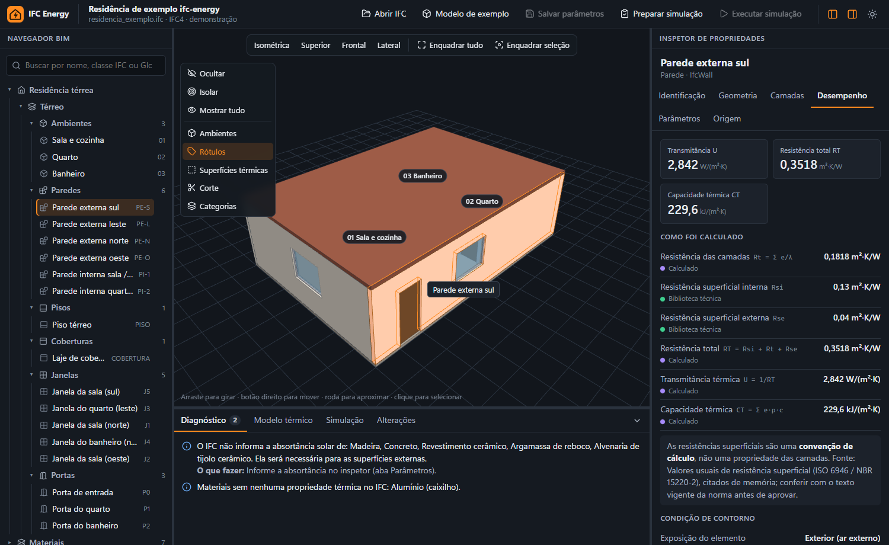

# ifc-energy

[](https://github.com/thiagotcg59/ifc-energy/actions/workflows/ci.yml)

Aplicação web que recebe o arquivo IFC de uma casa unifamiliar e faz a
simulação termoenergética com o [EnergyPlus](https://energyplus.net/).
Roda no seu próprio computador com Windows (localhost): **o IFC nunca sai da
máquina**.

**Demonstração (sem backend, com dados de exemplo):**
https://thiagotcg59.github.io/ifc-energy/



## O que já faz

- Abre um IFC4 e mostra o modelo em 3D com a **geometria real do arquivo**.
- Navegador BIM (ambientes, paredes, pisos, coberturas, janelas, portas,
  materiais e zonas térmicas) com busca por nome, classe IFC e GlobalId.
- Inspetor de propriedades: identificação, geometria, camadas, desempenho
  térmico (R, U, capacidade térmica), parâmetros editáveis e a **origem de
  cada valor** (IFC, calculado, manual, biblioteca ou não informado).
- Modelo térmico intermediário com checagens automáticas e superfícies
  coloridas pela condição de contorno.
- Simulação de ponta a ponta de um exemplo do EnergyPlus.

Ainda **não** faz a simulação do seu IFC: falta a conversão validada do
modelo térmico para o EnergyPlus. A interface deixa isso claro.

## Estado das fases

| Etapa | Conteúdo | Estado |
|---|---|---|
| Fase 1 | Repositório, CI, Pages e um exemplo do EnergyPlus de ponta a ponta | ✅ `v0.1.0` |
| Marco B | IFC sintético da residência de exemplo, leitura com origem dos valores | 🔧 aguardando aceite |
| Marco A | Interface de trabalho e visualizador 3D | 🔧 aguardando aceite |
| Marco C | Inspetor térmico paramétrico (edição, recálculo, persistência) | 🔧 aguardando aceite |
| Marco D | Modelo térmico, checagens e prontidão para simular | 🔧 aguardando aceite |
| Próxima | Conversão para epJSON com cargas ideais e simulação do IFC | ⏳ |
| Depois | Formulários de uso e clima; cenários; ventilação natural; split; normas | ⏳ |

O andamento detalhado fica em [docs/PROGRESSO.md](docs/PROGRESSO.md).

## Como rodar no Windows

Pré-requisitos (versões em [docs/versoes.md](docs/versoes.md)):

- [Git](https://git-scm.com/download/win)
- [uv](https://docs.astral.sh/uv/) (gerencia o Python do projeto)
- [Node.js](https://nodejs.org/) 24
- [EnergyPlus 26.2.0](https://github.com/NatLabRockies/EnergyPlus/releases/tag/v26.2.0)
  em `C:\EnergyPlusV26-2-0`

No PowerShell:

```powershell
git clone https://github.com/thiagotcg59/ifc-energy.git
cd ifc-energy
.\iniciar.ps1
```

O `iniciar.ps1` instala as dependências do projeto (só dentro da pasta do
projeto), inicia o backend e o front-end e abre http://localhost:5173 no
navegador. Para parar, pressione `Ctrl+C` na janela do PowerShell.

Se o PowerShell recusar o script, rode uma vez:

```powershell
Set-ExecutionPolicy -Scope CurrentUser RemoteSigned
```

Se o EnergyPlus estiver em outra pasta, copie `.env.example` para `.env` e
ajuste `IFC_ENERGY_ENERGYPLUS_DIR`.

## Testes

```powershell
cd backend
uv run pytest                 # rápidos (não precisam do EnergyPlus)
uv run pytest -m energyplus   # rodam o EnergyPlus de verdade (~15 s)
cd ..\frontend
npm test
node scripts/e2e.mjs          # navegador de verdade (com o iniciar.ps1 aberto)
```

## Organização

```
backend/    API (FastAPI), domínio, serviços, persistência e testes
frontend/   Interface (React + TypeScript + Vite)
docs/       Especificações, decisões, capturas de tela e PROGRESSO.md
exemplos/   IFC sintético da residência de exemplo e dados do modo demonstração
dados/      Uploads e execuções — fica só no seu computador
.agents/    Regras do projeto para assistentes de programação
```

A documentação interativa da API fica em http://localhost:8000/api/v1/docs
quando o backend está rodando.
