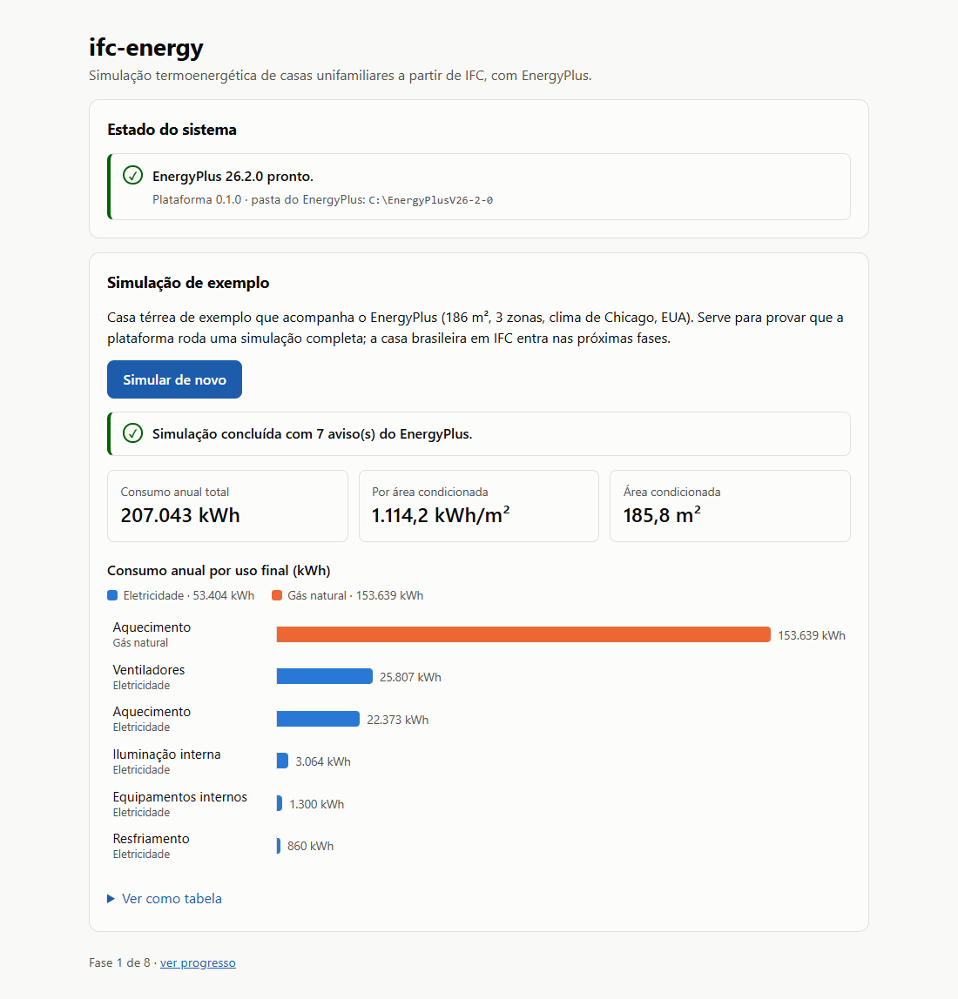

# Progresso

Atualizado a cada tarefa concluída: o que foi feito, como verificar e o que
vem depois. As mais recentes ficam no topo.

- Repositório: https://github.com/thiagotcg59/ifc-energy
- Demonstração: https://thiagotcg59.github.io/ifc-energy/

## Fase 1 — Fundação (aguardando aceite)

### 1.5 CI e publicação da demonstração

**Feito**

- `ci.yml`: em cada push roda ruff + pytest (backend) e eslint + prettier +
  vitest + compilação (front-end), e confere se os tipos da API estão em dia.
- `pages.yml`: a cada push na `main` compila o front-end em modo
  demonstração e publica no GitHub Pages.

**Como verificar**

- Selo verde no README e em https://github.com/thiagotcg59/ifc-energy/actions
- Abrir https://thiagotcg59.github.io/ifc-energy/ e clicar em
  "Simular exemplo": aparece a faixa "Modo demonstração" e os mesmos números
  da simulação local.

### 1.4 `iniciar.ps1` e capturas de tela

**Feito**

- `iniciar.ps1`: confere `uv` e `npm`, instala as dependências do projeto,
  inicia backend (porta 8000) e front-end (porta 5173), abre o navegador e
  encerra tudo com Ctrl+C.
- `frontend/scripts/capturar.mjs`: tira as capturas usando o Edge do
  Windows, clicando no botão e esperando a simulação real terminar.
- Capturas em [capturas/](capturas/): início, simulando, resultados (claro,
  escuro e celular).



**Como verificar**

```powershell
cd C:\Projetos\ifc-energy
.\iniciar.ps1
```

O navegador abre em http://localhost:5173. Clique em "Simular exemplo": em
cerca de 15 s aparecem as etapas e depois o consumo anual (207.043 kWh no
total; 53.404 kWh de eletricidade e 153.639 kWh de gás natural).

### 1.3 Front-end e modo demonstração

**Feito**

- Tela inicial em português (React + TypeScript + Vite): estado do sistema,
  botão "Simular exemplo", etapas da simulação e painel de consumo anual por
  uso final (números-resumo, barras e tabela).
- Estados de carregando, vazio e erro; mensagens de erro dizem o que fazer.
  Temas claro e escuro; funciona em tela de celular.
- Tipos do front-end gerados a partir do OpenAPI (`npm run gerar-tipos`).
- Modo demonstração (decisão [0004](decisoes/0004-modo-demonstracao.md)).
- 17 testes (vitest).

**Como verificar**

```powershell
cd C:\Projetos\ifc-energy\frontend
npm test        # 17 passam
npm run lint
```

### 1.2 Backend com o exemplo do EnergyPlus de ponta a ponta

**Feito**

- API em `/api/v1` (FastAPI): `saude`, `simulacoes/exemplo`, `simulacoes`,
  `simulacoes/{id}` e `simulacoes/{id}/resultados`.
- Simulação em segundo plano: fila no SQLite, uma thread processa
  (decisão [0003](decisoes/0003-fila-de-simulacoes.md)).
- Antes de simular: validação do epJSON contra o esquema da versão instalada
  e simulação dos dias de projeto; só então a simulação anual.
- Leitura do consumo anual por uso final a partir do `eplusout.sql`.
- Dados do modo demonstração gerados pelo backend real em `exemplos/demo/`.
- 25 testes rápidos e 3 testes com o EnergyPlus real.

**Como verificar**

```powershell
cd C:\Projetos\ifc-energy\backend
uv run pytest                 # 25 passam em ~1 s
uv run pytest -m energyplus   # 3 passam em ~15 s (roda o EnergyPlus)
```

### 1.1 Repositório, regras e EnergyPlus

**Feito**

- Pasta `C:\Projetos\ifc-energy` (fora do OneDrive) e repositório público no
  GitHub.
- `.gitignore` criado antes do primeiro commit (bloqueia IFCs reais,
  `dados/`, saídas do EnergyPlus, `.env` e arquivos climáticos).
- Regras gravadas em `AGENTS.md` e `.agents/rules/`.
- EnergyPlus 26.2.0 descompactado em `C:\EnergyPlusV26-2-0`, com o hash do
  arquivo conferido com o publicado ([versões](versoes.md)).
- Decisões [0001](decisoes/0001-pilha-e-ferramentas.md) e
  [0002](decisoes/0002-energyplus-26-2-e-exemplo.md).

**Como verificar**

```powershell
C:\EnergyPlusV26-2-0\energyplus.exe --version   # deve mostrar 26.2.0
cd C:\Projetos\ifc-energy
git log --oneline
```

## O que vem depois

- Aceite da fase 1 pelo dono e tag `v0.1.0`.
- Fase 2: IFC sintético de um único ambiente → diagnóstico → modelo térmico
  → epJSON com cargas ideais, com testes de resposta conhecida.
