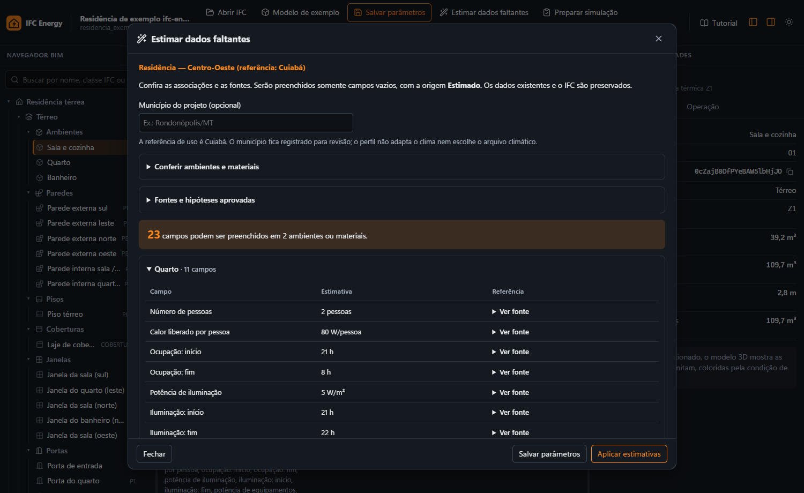
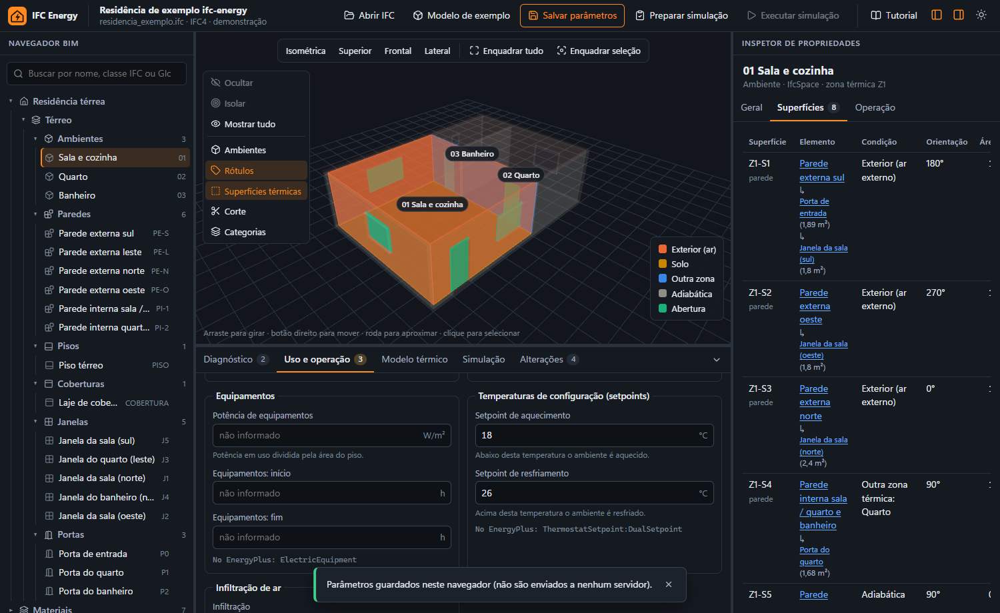

# Progresso

Atualizado a cada tarefa concluída: o que foi feito, como verificar e o que
vem depois. As mais recentes ficam no topo.

- Repositório: https://github.com/thiagotcg59/ifc-energy
- Demonstração: https://thiagotcg59.github.io/ifc-energy/

## Estimativas para residência no Centro-Oeste — interface aguardando aceite

Feito em 16/11/2026. Plano aprovado pelo dono; tabela e adaptações aprovadas
pela resposta “Aprovar a tabela e as adaptações”. Referências completas em
[spec/estimativas-centro-oeste.md](spec/estimativas-centro-oeste.md) e decisão
em [decisoes/0009-estimativas-centro-oeste.md](decisoes/0009-estimativas-centro-oeste.md).



- Botão **Estimar dados faltantes** na barra superior, com prévia por
  ambiente e material, fontes, hipóteses e motivos das pendências.
- Associações sugeridas pelo nome podem ser revistas antes de aplicar. O
  município é um registro separado; não substitui o clima do projeto.
- Somente lacunas recebem valores. Preserva zero, valores existentes e
  IFC original; cada novo valor mostra **Estimado**, fonte e aplicação.
- **Desfazer estimativas** por aplicação, preservando edições manuais feitas
  depois. Salvamento, reabertura e arquivos de parâmetros mantêm a origem e
  o registro para desfazer; funciona no modo local e na demonstração.
- Proteções contra horários/setpoints incompatíveis, duplicação de pessoas
  entre salas, vidro de espessura incompatível e propriedades ópticas cuja
  soma seria maior que um. Sem IfcSpace, não aplica estimativas.
- Banheiro, cozinha separada e outros usos sem perfil, materiais sem
  correspondência, espessuras, clima e U/SHGC da janela inteira continuam
  pendentes. **A simulação do IFC continua indisponível** até a conversão
  validada para epJSON. A biblioteca didática não recebeu aprovação global.
- Nenhuma dependência instalada; fórmulas térmicas não foram alteradas.

**Validação:** testes escritos antes da implementação; 78 testes do
front-end e 85 testes rápidos do backend passaram, além de lint, formatação,
tipagem e compilação da demonstração. Os quatro testes com EnergyPlus
ficaram fora desta rodada, pois não há mudança na simulação. No Edge,
verificados prévia sem alteração, preservação de zero, aplicar, salvar,
reabrir, desfazer preservando edição posterior e bloqueio da simulação,
tanto na demonstração quanto no backend com dados sintéticos isolados.
Também conferidos foco por teclado, temas claro/escuro e tela de celular.
O roteiro existente de 18 etapas passou na demonstração, cobrindo o modelo
3D, materiais, edição, persistência, tutorial e resultados do exemplo.
Capturas: [claro](capturas/estimativas-local-claro.png),
[celular](capturas/estimativas-local-celular.png),
[valores aplicados](capturas/estimativas-local-aplicadas.png) e
[desfazer](capturas/estimativas-local-desfeitas.png).

**Como verificar:** executar `./iniciar.ps1`, abrir a residência de exemplo
e clicar em **Estimar dados faltantes**. Conferir a prévia e as pendências,
clicar em **Aplicar estimativas** e depois **Salvar parâmetros**. Em
**Uso e operação**, os campos mostram a origem. No mesmo diálogo, escolher
uma aplicação e clicar em **Desfazer estimativas**; salvar novamente para
guardar o resultado. O próximo marco é o aceite dessa interface pelo dono.

## Formulário de uso e operação e tutorial (aguardando aceite)

Feito em 16/11/2026, a pedido do dono.



**Feito**

- Aba **Uso e operação** no painel inferior: por ambiente, ocupação (pessoas,
  calor por pessoa, horário), iluminação e equipamentos (W/m² e horário),
  setpoints de aquecimento e resfriamento e infiltração (trocas de ar por
  hora).
- **Nenhum campo vem preenchido e a plataforma não sugere valores.** O que é
  digitado fica com a origem "manual", entra no histórico e é salvo junto com
  os outros parâmetros (campo `operacao` dos ajustes), separado do IFC.
- Limites só para barrar erro de digitação; o setpoint de resfriamento
  precisa ser maior que o de aquecimento; início e fim do horário não podem
  ser iguais.
- "Copiar para os outros ambientes" e "Apagar os dados deste ambiente".
- A etapa de prontidão "Ocupação, iluminação, equipamentos e setpoints"
  deixou de ser "não implementado": fica pendente até todos os ambientes
  estarem completos. **A simulação do IFC continua indisponível** (falta a
  conversão para epJSON).
- A aba "Operação" do inspetor do ambiente mostra os valores informados, com
  a origem, e leva ao formulário.
- **Tutorial** em 9 passos (botão "Tutorial" na barra superior e link na tela
  inicial), com atalhos que levam à parte da tela de que cada passo fala.

**Como verificar**

```powershell
cd C:\Projetos\ifc-energy
.\iniciar.ps1
```

1. Na tela inicial, clique em **Como usar a plataforma**: o tutorial abre.
2. Abra a residência de exemplo e clique em **Tutorial** na barra superior.
   No passo 7, clique em **Ir para o formulário**.
3. Clique em **Sala e cozinha** no topo do formulário e preencha alguns
   campos. Tente `5000` na potência de iluminação: é recusado.
4. **Salvar parâmetros**, recarregue (F5) e abra o exemplo: os valores
   continuam.
5. **Preparar simulação**: a etapa de uso mostra "x de 3 ambientes".

**Testes:** 87 no backend (4 com o EnergyPlus real), 65 no front-end e 18
etapas no navegador (demonstração e modo local).

**Um teste antigo teve o texto esperado trocado, e não foi para fazê-lo
passar:** o teste do inspetor do ambiente procurava a linha única
"Temperaturas de configuração", que deu lugar a uma linha por setpoint. A
verificação continua a mesma: sem preenchimento, aparece "Não informado".

**Simplificações desta primeira versão (decisão 0008):** horários iguais
todos os dias, um intervalo por dia, setpoints valendo o dia inteiro. Dias
úteis e fins de semana, e a ventilação natural, ficam para depois.

## Evolução BIM — marcos B, A, C e D (aguardando aceite)

Plano: [spec/plano-evolucao-bim.md](spec/plano-evolucao-bim.md). Feito de
15 para 16/11/2026, com o plano aprovado por delegação.


### B. IFC sintético da residência de exemplo

**Feito**

- `exemplos/ifc/residencia_exemplo.ifc`: casa térrea IFC4 de 70 m², 3
  ambientes, 6 paredes, piso, cobertura, 5 janelas, 3 portas, camadas,
  materiais com propriedades e 30 fronteiras de espaço de 2º nível
  ([especificação](spec/residencia-exemplo.md)).
- Gerador reproduzível: `backend/ferramentas/gerar_residencia_ifc.py`.
- Leitura do IFC com a origem de cada valor (`app/dominio/modelo_bim.py`).

**Como verificar**

```powershell
cd C:\Projetos\ifc-energy\backend
uv run pytest tests/test_residencia_ifc.py
```

### A. Interface e visualizador 3D

**Feito**

- Área de trabalho: barra superior, navegador BIM com busca, visualizador 3D,
  inspetor de propriedades e painel inferior; painéis redimensionáveis e
  recolhíveis; temas escuro e claro.
- Visualizador com a geometria real do IFC (web-ifc + three.js, decisão
  [0005](decisoes/0005-visualizador-ifc.md)): girar, aproximar, mover,
  selecionar por clique, enquadrar, ocultar, isolar, transparência e
  visibilidade por categoria, vistas, rótulos dos ambientes e corte
  horizontal.
- Árvore e 3D sincronizados nos dois sentidos.

### C. Inspetor térmico paramétrico

**Feito**

- Seis abas: Identificação, Geometria, Camadas, Desempenho, Parâmetros e
  Origem; inspetores próprios para janelas, ambientes e materiais.
- R, U e capacidade térmica com método explícito (decisão
  [0007](decisoes/0007-calculo-termico-e-convencoes.md)).
- Edição com limites físicos e recálculo imediato; trocar material,
  acrescentar e remover camadas; restaurar; histórico; salvar; exportar e
  importar (decisão [0006](decisoes/0006-origem-dos-valores-e-ajustes.md)).

### D. Preparação para a análise energética

**Feito**

- Modelo térmico intermediário (zonas, superfícies, aberturas, pares,
  suposições) com cinco checagens automáticas.
- Superfícies térmicas no 3D, coloridas pela condição de contorno; ao
  selecionar um ambiente aparecem os limites dele.
- Painel "Modelo térmico" com a prontidão para simular. A conversão para
  epJSON **não** foi feita: "Executar simulação" fica desabilitado e a tela
  explica o motivo.

**Como verificar (tudo)**

```powershell
cd C:\Projetos\ifc-energy
.\iniciar.ps1
```

1. Clique em **Explorar residência de exemplo**: a casa aparece em 3D.
2. Clique na parede da frente: o inspetor abre "Parede externa sul".
3. Aba **Desempenho**: U = 2,842 W/(m²·K).
4. Aba **Parâmetros**: abra a camada 2 e troque a espessura para `0,20`. U
   passa para 2,154.
5. **Salvar parâmetros**, recarregue a página (F5), abra o exemplo de novo e
   confira que o valor continua.
6. No navegador BIM, clique em **Sala e cozinha**: o 3D mostra as superfícies
   do ambiente coloridas.
7. **Preparar simulação**: checagens e o que falta.

Teste automático em navegador de verdade (com o `iniciar.ps1` aberto em
outra janela):

```powershell
cd C:\Projetos\ifc-energy\frontend
node scripts/e2e.mjs
```

**Testes:** 85 no backend (4 deles com o EnergyPlus real), 59 no front-end e
16 etapas no navegador.

**Pendências que dependem de você** (detalhes na decisão 0007): aprovar ou
trocar a biblioteca de materiais e conferir as resistências superficiais com
o texto da norma.

## Fase 1 — Fundação (aceita, `v0.1.0`)

### 1.5 CI e publicação da demonstração

**Feito**

- `ci.yml`: em cada push roda ruff + pytest (backend) e eslint + prettier +
  vitest + compilação (front-end), e confere se os tipos da API estão em dia.
- `pages.yml`: a cada push na `main` compila o front-end em modo
  demonstração e publica no GitHub Pages.

**Como verificar**

- Selo verde no README e em https://github.com/thiagotcg59/ifc-energy/actions
- Abrir https://thiagotcg59.github.io/ifc-energy/ e clicar em
  "Simular exemplo": aparece a faixa "Modo demonstração" e os mesmos números
  da simulação local.

### 1.4 `iniciar.ps1` e capturas de tela

**Feito**

- `iniciar.ps1`: confere `uv` e `npm`, instala as dependências do projeto,
  inicia backend (porta 8000) e front-end (porta 5173), abre o navegador e
  encerra tudo com Ctrl+C.
- `frontend/scripts/capturar.mjs`: tira as capturas usando o Edge do
  Windows, clicando no botão e esperando a simulação real terminar.
- Capturas em [capturas/](capturas/): início, simulando, resultados (claro,
  escuro e celular).


**Como verificar**

```powershell
cd C:\Projetos\ifc-energy
.\iniciar.ps1
```

O navegador abre em http://localhost:5173. Clique em "Simular exemplo": em
cerca de 15 s aparecem as etapas e depois o consumo anual (207.043 kWh no
total; 53.404 kWh de eletricidade e 153.639 kWh de gás natural).

### 1.3 Front-end e modo demonstração

**Feito**

- Tela inicial em português (React + TypeScript + Vite): estado do sistema,
  botão "Simular exemplo", etapas da simulação e painel de consumo anual por
  uso final (números-resumo, barras e tabela).
- Estados de carregando, vazio e erro; mensagens de erro dizem o que fazer.
  Temas claro e escuro; funciona em tela de celular.
- Tipos do front-end gerados a partir do OpenAPI (`npm run gerar-tipos`).
- Modo demonstração (decisão [0004](decisoes/0004-modo-demonstracao.md)).
- 17 testes (vitest).

**Como verificar**

```powershell
cd C:\Projetos\ifc-energy\frontend
npm test        # 17 passam
npm run lint
```

### 1.2 Backend com o exemplo do EnergyPlus de ponta a ponta

**Feito**

- API em `/api/v1` (FastAPI): `saude`, `simulacoes/exemplo`, `simulacoes`,
  `simulacoes/{id}` e `simulacoes/{id}/resultados`.
- Simulação em segundo plano: fila no SQLite, uma thread processa
  (decisão [0003](decisoes/0003-fila-de-simulacoes.md)).
- Antes de simular: validação do epJSON contra o esquema da versão instalada
  e simulação dos dias de projeto; só então a simulação anual.
- Leitura do consumo anual por uso final a partir do `eplusout.sql`.
- Dados do modo demonstração gerados pelo backend real em `exemplos/demo/`.
- 25 testes rápidos e 3 testes com o EnergyPlus real.

**Como verificar**

```powershell
cd C:\Projetos\ifc-energy\backend
uv run pytest                 # 25 passam em ~1 s
uv run pytest -m energyplus   # 3 passam em ~15 s (roda o EnergyPlus)
```

### 1.1 Repositório, regras e EnergyPlus

**Feito**

- Pasta `C:\Projetos\ifc-energy` (fora do OneDrive) e repositório público no
  GitHub.
- `.gitignore` criado antes do primeiro commit (bloqueia IFCs reais,
  `dados/`, saídas do EnergyPlus, `.env` e arquivos climáticos).
- Regras gravadas em `AGENTS.md` e `.agents/rules/`.
- EnergyPlus 26.2.0 descompactado em `C:\EnergyPlusV26-2-0`, com o hash do
  arquivo conferido com o publicado ([versões](versoes.md)).
- Decisões [0001](decisoes/0001-pilha-e-ferramentas.md) e
  [0002](decisoes/0002-energyplus-26-2-e-exemplo.md).

**Como verificar**

```powershell
C:\EnergyPlusV26-2-0\energyplus.exe --version   # deve mostrar 26.2.0
cd C:\Projetos\ifc-energy
git log --oneline
```

## O que vem depois

- Aceite dos marcos B, A, C e D e tag `v0.2.0`.
- Conversão do modelo térmico para epJSON com cargas ideais, validada contra
  o esquema e com os dias de projeto, para então liberar a simulação do IFC.
- Escolha do arquivo climático pela localização do IfcSite.
- Superfícies pela geometria dos ambientes, para IFC sem fronteiras de 2º nível.
